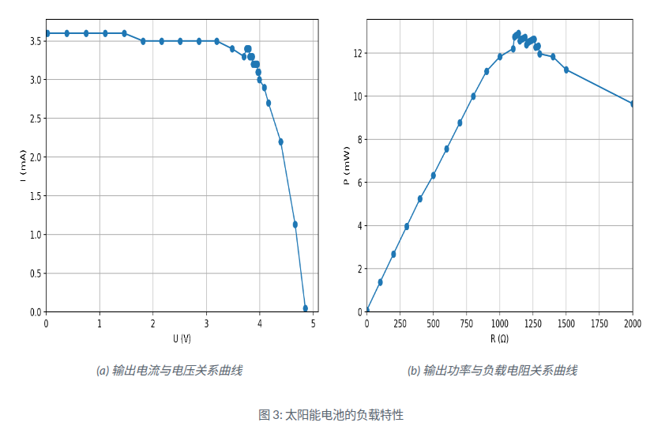
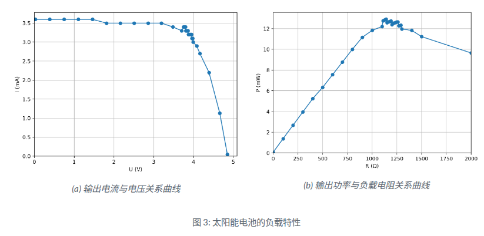
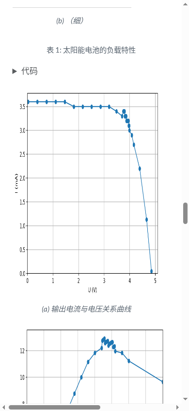
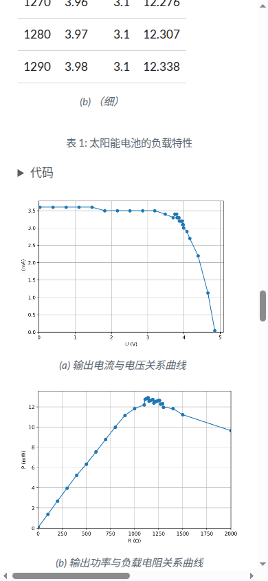

# sunquartex graphics on Quarto 1.11.9

I rendered the Chinese article on current [master, `b88a4f3`](https://github.com/sun123zxy/sunquartex/commit/b88a4f3da9e0099765adcde97bd31cd880b947e1) with [Quarto 1.11.9](https://github.com/quarto-dev/quarto-cli/releases/tag/v1.11.9), TinyTeX and Chromium 141. Each after view starts with that same commit and applies only the relevant PR's SCSS diff. Desktop is 1280 px wide and mobile is 390 px wide.

## PR 19 · Subfigure aspect ratios

| View | Master | With PR 19 |
| --- | --- | --- |
| Desktop |  |  |
| Mobile |  |  |

The two chart ratios were off by 34.00% and 35.37% on desktop, and by 48.49% and 46.24% on mobile. The same four measurements round to 0.00% with the patch. The explicit-width polar plot also shrank from 450 px to 324 px on mobile. The example page still has horizontal overflow elsewhere.

[The standalone Quarto document](stock-quarto.qmd) reproduces the subfigure distortion without the sunquartex theme. Quarto emits fixed image dimensions and [its layout rule constrains the width](https://github.com/quarto-dev/quarto-cli/blob/v1.11.9/src/resources/formats/html/_quarto-rules.scss#L81-L83). [PR 19](https://github.com/sun123zxy/sunquartex/pull/19) lets the height scale with the constrained width.

## PR 20 · Dark mode for TikZ

| Master | With PR 20 |
| --- | --- |
|  |  |

All six TikZ images in the example had only a drop shadow on master. [PR 20](https://github.com/sun123zxy/sunquartex/pull/20) applies `invert(1) hue-rotate(180deg)` to the rendered `img` elements in dark mode, as the existing rule already did for inline SVG.
